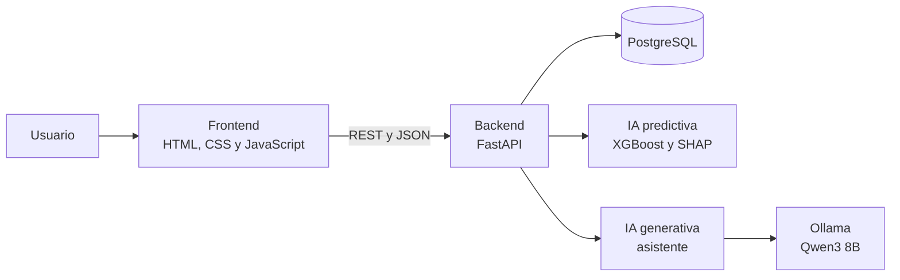
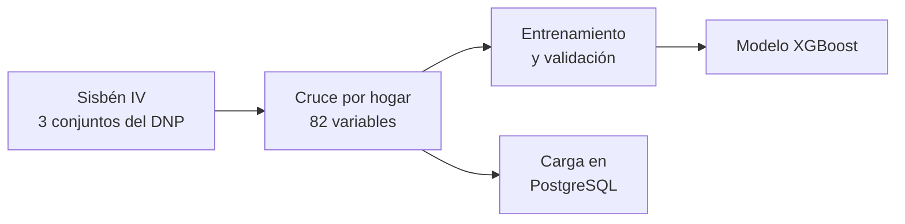

# SocialData

**Analítica e inteligencia artificial para entender la vulnerabilidad
socioeconómica del Área Metropolitana de Bucaramanga.**

**Página:** https://juancarreno78.github.io/PI2---SocialData/

## El proyecto

En el Área Metropolitana de Bucaramanga, 4 de cada 10 hogares registrados en el
Sisbén están en pobreza extrema. Decidir dónde intervenir primero exige cruzar
muchos indicadores, y esa información suele estar dispersa en bases de datos
difíciles de consultar.

SocialData reúne esos datos en una sola plataforma web. Muestra cómo se
distribuye la pobreza en Bucaramanga, Floridablanca, Girón y Piedecuesta, qué
privaciones pesan más en cada zona y qué estima un modelo de inteligencia
artificial. Un asistente conversacional traduce las cifras a conclusiones y
recomendaciones en lenguaje claro.

Está pensada para funcionarios públicos y analistas sin conocimientos técnicos
avanzados, y se alinea con los Objetivos de Desarrollo Sostenible 10 (reducción
de las desigualdades) y 11 (ciudades y comunidades sostenibles).

## Funcionalidades

- **Análisis territorial:** mapa interactivo de las 8 zonas del área
  metropolitana (cabecera urbana y zona rural de cada municipio), coloreadas
  según el porcentaje de hogares en pobreza extrema, con las 15 privaciones del
  Índice de Pobreza Multidimensional agrupadas en 4 dimensiones: educación,
  salud, trabajo, y vivienda y servicios.
- **Analítica predictiva:** estimación del modelo XGBoost para cada zona,
  comparada con lo observado en el Sisbén, y explicación de cada estimación con
  valores SHAP (qué factores empujan a la zona hacia un grupo u otro).
- **Asistente de inteligencia artificial:** conversación en lenguaje natural
  sobre cualquier zona, con conclusiones y recomendaciones de política pública
  que indican la entidad que suele liderar cada intervención.
- **Reportes:** exportación del reporte de una zona en PDF o en Excel. El PDF
  incluye un resumen de la conversación con el asistente.
- **Gestión de usuarios:** roles de analista y administrador, administración de
  cuentas y perfil propio con cambio de contraseña.
- **Modo claro y modo oscuro.**

## Cómo funciona

### Arquitectura

La plataforma está formada por servicios independientes que se comunican por
REST y JSON, cada uno en su propio contenedor de Docker. Sigue un esquema de
capas cerradas: el navegador solo habla con el backend, y el backend es el único
que accede a la base de datos y a los servicios de inteligencia artificial.



| Componente | Función | Tecnología |
|---|---|---|
| Frontend (este repositorio) | Interfaz web: mapa, indicadores, ficha técnica y chat | HTML, CSS y JavaScript con módulos ES; Leaflet para el mapa |
| Backend | API, autenticación, control de acceso por rol y bitácora | FastAPI (Python) |
| Base de datos | Hogares, indicadores, usuarios y registros de auditoría | PostgreSQL |
| IA predictiva | Clasificación de hogares y explicación de cada resultado | XGBoost y SHAP |
| IA generativa | Redacción de conclusiones, recomendaciones y respuestas | Ollama con el modelo Qwen3 8B |

Si alguno de los servicios de inteligencia artificial no está disponible, el
resto de la plataforma sigue funcionando.

### Proceso de los datos



1. **Fuente.** Se toman los tres conjuntos de datos del Sisbén IV publicados por
   el DNP (personas, hogares y vivienda) y se filtran a los cuatro municipios del
   área metropolitana.
2. **Construcción del dataset.** Los tres se cruzan para obtener una fila por
   hogar: 10.288 hogares con 82 variables (vivienda, educación, salud, trabajo y
   composición del hogar) y las 15 privaciones del IPM.
3. **Entrenamiento.** Se compararon 13 configuraciones de 6 algoritmos (entre
   ellos regresión logística, Random Forest, LightGBM y XGBoost). XGBoost obtuvo
   el mejor resultado y se validó con validación cruzada de 5 particiones.
4. **Carga.** Los hogares se cargan en PostgreSQL y el modelo entrenado queda
   disponible para el servicio de IA predictiva.

### Qué ocurre cuando un usuario consulta una zona

1. **Inicio de sesión.** El backend verifica la contraseña (guardada cifrada con
   bcrypt) y entrega un token de sesión con el rol del usuario, válido por 8
   horas.
2. **Indicadores.** El frontend pide los datos de la zona y el backend los
   consulta en PostgreSQL.
3. **Predicción.** El backend envía los hogares de la zona al servicio de IA
   predictiva, que clasifica cada hogar y devuelve la distribución estimada por
   grupo. Para explicar el resultado, calcula los valores SHAP del hogar
   representativo de la zona.
4. **Presentación.** El frontend dibuja el mapa, las métricas, las privaciones y
   la ficha técnica con la predicción y sus factores.
5. **Asistente.** Si el usuario pregunta, el backend arma un resumen de la zona
   solo con cifras ya calculadas y lo envía al asistente. Este busca contexto en
   una base de conocimiento propia (metodología del Sisbén, Índice de Pobreza
   Multidimensional, líneas de intervención y ODS) y le pide al modelo de
   lenguaje que redacte la respuesta, que llega por partes mientras se escribe.

**Principio de anclaje:** el modelo de lenguaje nunca calcula. Solo redacta
cifras que ya vienen del modelo predictivo o de la base de datos, de modo que
cada número que aparece en pantalla se puede rastrear hasta su origen.

## Modelo de inteligencia artificial

| Característica | Valor |
|---|---|
| Algoritmo | XGBoost, clasificación multiclase |
| Variable objetivo | Grupo del Sisbén IV (A, B, C o D) |
| Datos de entrenamiento | 10.288 hogares y 28.656 personas |
| Variables predictoras | 82 |
| Validación | Validación cruzada estratificada de 5 particiones |
| Exactitud | 79,6 % (un clasificador trivial obtiene 41,0 %) |
| F1 macro | 0,78 |
| ROC-AUC | 0,95 |
| Kappa de Cohen | 0,70 |
| Acierto con tolerancia de un grupo | 99,6 % |

Controles de validez aplicados:

- Se excluyeron las variables derivadas del grupo del Sisbén, para evitar que el
  modelo aprendiera la respuesta directamente.
- Con el grupo asignado al azar, la exactitud cae a 37,2 %, lo que confirma que
  el modelo aprende de los datos y no de un atajo.
- Entrenado con tres municipios y evaluado en el cuarto, mantiene una exactitud
  entre 64,3 % y 72,9 %.
- Las cifras que muestra la página se verificaron recalculándolas directamente
  con el modelo, sin pasar por la plataforma.

## Seguridad y protección de datos

- Acceso restringido con roles de analista y administrador, verificados en el
  servidor en cada consulta.
- Contraseñas cifradas con bcrypt, bloqueo de la cuenta durante 15 minutos tras
  5 intentos fallidos y límite de consultas por minuto a la inteligencia
  artificial.
- Solo se muestran cifras agregadas por zona: ningún dato permite identificar a
  un hogar o a una persona, en cumplimiento de la Ley 1581 de 2012 (Habeas
  Data).
- Las acciones sensibles quedan registradas en una bitácora de auditoría.

## Acceso

La plataforma tiene acceso restringido. Las credenciales de demostración las
proporciona el equipo del proyecto.

Cuando el servidor del proyecto está en línea, los datos y la inteligencia
artificial se consultan en vivo. Si no lo está, la página funciona en modo de
demostración con los datos publicados, y el asistente responde con plantillas.

## Ejecución local

La página necesita un servidor local, porque los módulos de JavaScript no
funcionan al abrir el archivo directamente. Basta con la extensión Live Server
de VS Code o con:

```bash
python -m http.server 5173
```

y abrir http://localhost:5173 en el navegador.

## Estructura del repositorio

```
index.html          estructura de la página
config.js           dirección del servidor
css/styles.css      estilos
js/model.js         datos y sesión
js/map.js           mapa
js/view.js          presentación de la información
js/chat.js          asistente
js/app.js           controlador
js/theme.js         modo claro y oscuro
api/data.json       datos del modo de demostración
vendor/leaflet/     librería del mapa
```

El frontend sigue el patrón Modelo, Vista y Controlador: `model.js` obtiene los
datos, `view.js` los presenta y `app.js` atiende las acciones del usuario.

## Datos

Muestra anonimizada del Sisbén IV, corte de marzo de 2022, publicada por el
Departamento Nacional de Planeación en datos.gov.co bajo licencia CC BY-SA 4.0.

Limitaciones:

- El Sisbén publica la información hasta el nivel de municipio y zona, no por
  comuna. Por eso la unidad de análisis son las 8 zonas.
- Corresponde a la población registrada en el Sisbén, no a la población general.

SocialData es una herramienta de apoyo a la decisión: no reemplaza la
clasificación oficial del Sisbén.

## Autores

Equipo 2, Proyecto Integrador II, Universidad Pontificia Bolivariana, seccional
Bucaramanga, 2026.
